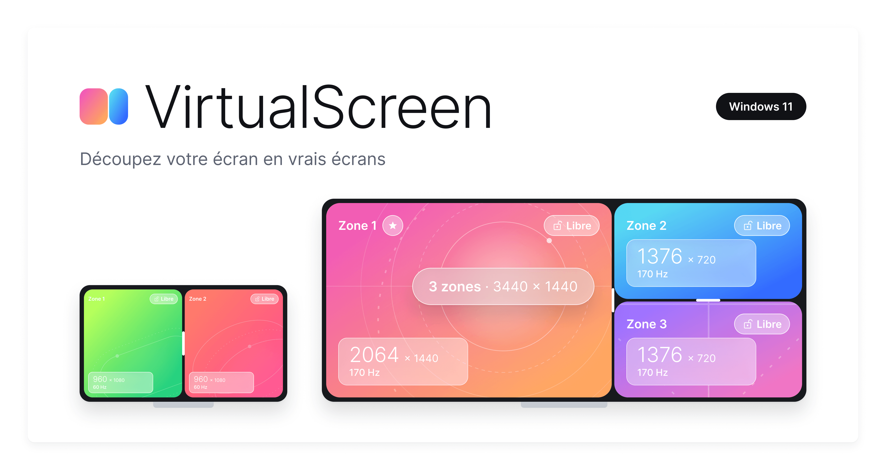
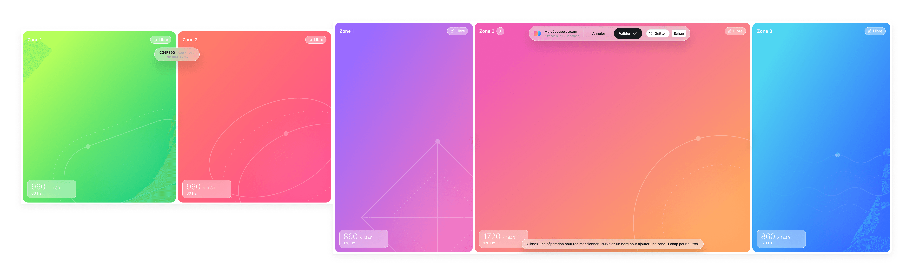
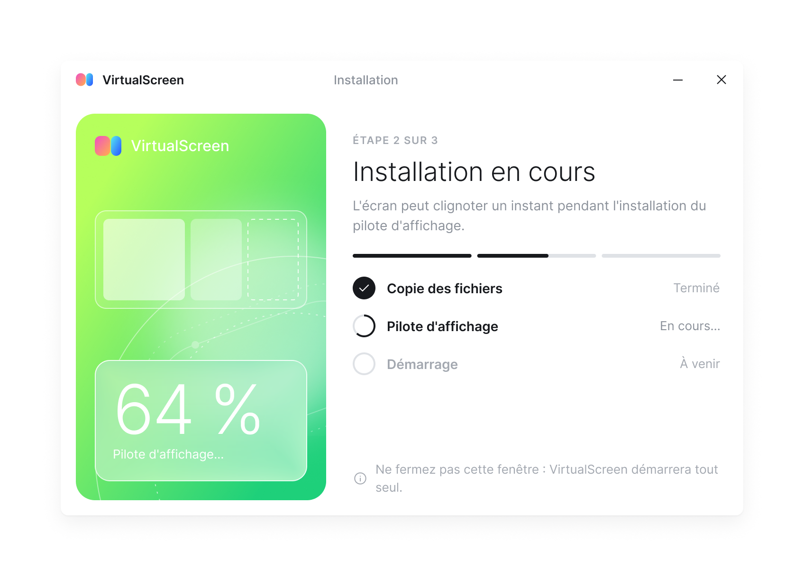
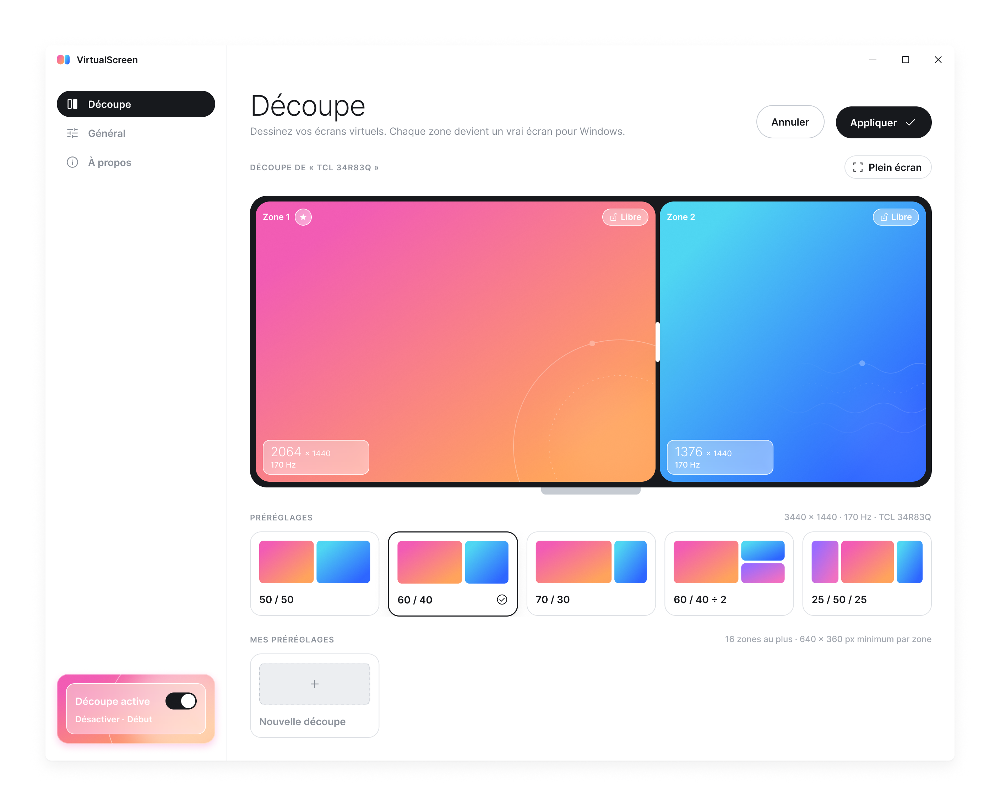
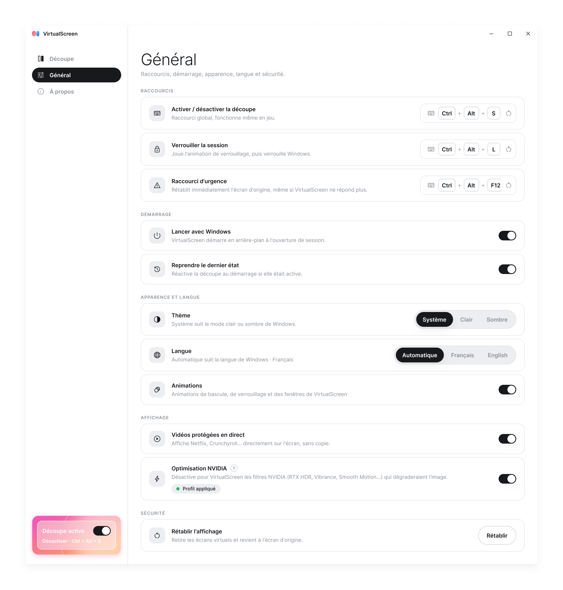
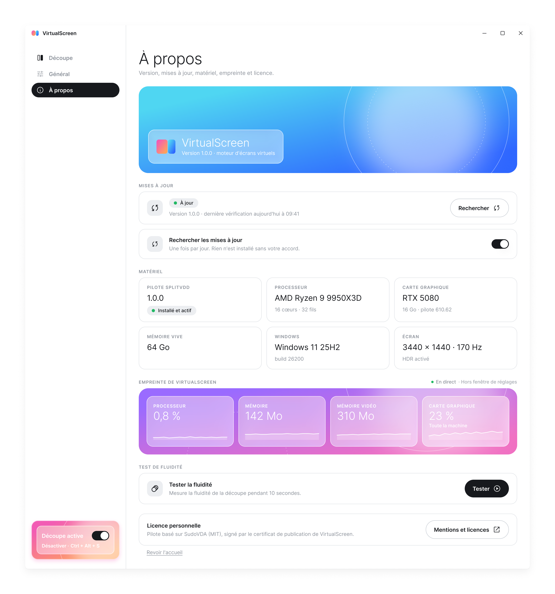

# VirtualScreen

**Français** · [English](#english)

  

<h3 align="center">Un écran. Plusieurs vrais écrans.</h3>

<!-- VIDEO -->

VirtualScreen découpe n'importe quel écran — écran de bureau, portable, ultra-large ou téléviseur — en plusieurs zones que Windows traite comme des écrans séparés. Chaque zone accueille ses propres fenêtres, se maximise et passe en plein écran sans toucher aux autres : une vidéo en plein écran dans un coin, votre travail à côté.

- **Découpe en zones** : préréglages prêts à l'emploi ou découpe personnalisée, dans un éditeur plein écran.
- **Plusieurs écrans** : découpez les écrans de votre choix, chacun avec sa propre découpe.
- **Vidéos protégées** : Netflix, Crunchyroll, Disney+ ou YouTube en plein écran dans une zone, avec l'accélération matérielle, sans aucune copie du contenu.
- **HDR et cartes NVIDIA** pris en charge, animations de bascule, test de fluidité.
- **Raccourcis** : `Ctrl+Alt+S` active ou désactive la découpe ; `Ctrl+Alt+Maj+F12` arrête tout et rétablit l'affichage d'origine.
- En français et en anglais.

## En images

   
  <b>L'éditeur plein écran</b>, ouvert sur tous vos écrans à la fois.

<table>
  <tr>
    <td width="50%" valign="top" align="center">
       
      <b>Installation</b> : quelques clics, puis VirtualScreen démarre tout seul.
    </td>
    <td width="50%" valign="top" align="center">
       
      <b>Découpe</b> : un préréglage en un clic, ou votre propre découpe.
    </td>
  </tr>
  <tr>
    <td width="50%" valign="top" align="center">
       
      <b>Général</b> : raccourcis, démarrage, langue, vidéos protégées, NVIDIA.
    </td>
    <td width="50%" valign="top" align="center">
       
      <b>À propos</b> : mises à jour, matériel, empreinte et test de fluidité.
    </td>
  </tr>
</table>

Images tirées des maquettes de l'application ; les noms d'écrans et les valeurs affichées sont des exemples.

## Télécharger

La dernière version se trouve dans les [releases](https://github.com/Mats-TH/VirtualScreen/releases/latest) : téléchargez `VirtualScreen-x.y.z-setup.exe`. Ce dépôt ne contient que les versions publiées et leur documentation, pas le code source.

## Configuration requise

- Windows 11 version 22H2 ou plus récente, 64 bits (x64). Windows 10 et Windows sur ARM ne sont pas pris en charge.
- Une carte graphique compatible DirectX 11 avec un pilote à jour ; les écrans à découper doivent être branchés sur la même carte graphique.
- Un compte administrateur de l'ordinateur pour l'installation (VirtualScreen installe un pilote d'écran virtuel).
- Le runtime Microsoft Edge WebView2 (présent sur Windows 11 ; installé automatiquement s'il manque).

## Installation

1. Téléchargez `VirtualScreen-x.y.z-setup.exe` depuis la page de la release.
2. Facultatif mais conseillé : vérifiez son empreinte. Dans PowerShell, `Get-FileHash .\VirtualScreen-x.y.z-setup.exe` doit afficher la valeur SHA-256 indiquée dans `SHA256SUMS.txt` de la même release.
3. Lancez l'installateur et suivez l'assistant (accord de licence, puis installation dans `C:\Program Files\VirtualScreen`).
4. Au premier lancement, VirtualScreen installe son pilote d'écran virtuel après vous l'avoir demandé.

**Avertissement de Windows SmartScreen.** VirtualScreen n'est pas encore signé par une autorité de certification reconnue. Au premier lancement de l'installateur, Windows peut afficher « Windows a protégé votre ordinateur ». Après avoir vérifié l'empreinte du fichier, cliquez sur « Informations complémentaires » puis « Exécuter quand même ». Cet avertissement disparaîtra quand l'installateur sera signé.

**Certificat du pilote.** Le pilote d'écran virtuel (SplitVdd) est signé par le certificat de publication de VirtualScreen. Pour que Windows l'accepte, l'installation ajoute ce certificat aux certificats approuvés de l'ordinateur (magasins « Autorités de certification racines de confiance » et « Éditeurs approuvés »), restreint à la seule signature de code : il ne peut servir à rien d'autre. La désinstallation le retire. Seul le certificat attendu par VirtualScreen (empreinte vérifiée) est ajouté.

## Désinstallation

Paramètres de Windows → Applications → Applications installées → VirtualScreen → Désinstaller. La désinstallation rétablit l'affichage d'origine, retire le pilote, sa confiance et la tâche de démarrage. Vos réglages sont gardés, sauf si vous cochez « Supprimer aussi mes réglages ».

## Mises à jour

VirtualScreen **propose** les nouvelles versions sans jamais les installer seul : une notification et l'onglet « À propos » vous préviennent, vous installez d'un clic quand vous le souhaitez. Chaque mise à jour est vérifiée avant installation (manifeste signé, empreinte SHA-256 de l'installateur). Si une nouvelle version ne démarre pas, la version précédente est remise en place automatiquement. La recherche des mises à jour peut être désactivée dans « À propos ».

## Confidentialité

Rien n'est envoyé hors de votre ordinateur, à une seule exception : une fois par jour (si la recherche des mises à jour est activée), VirtualScreen lit le fichier de mise à jour publié dans ce dépôt GitHub. Cette lecture ne transmet que ce que toute connexion à GitHub transmet : votre adresse IP et la version de VirtualScreen. Aucune télémétrie, aucun compte, aucune publicité. Le téléchargement d'une mise à jour, lui, n'a lieu que si vous cliquez sur « Installer ».

## Aide, problèmes et sécurité

- En cas de problème d'affichage : `Ctrl+Alt+Maj+F12`, ou `Win+P` puis « Écran du PC uniquement ».
- Signaler un bug ou proposer une idée : [Issues](https://github.com/Mats-TH/VirtualScreen/issues).
- Signaler une faille de sécurité : **jamais dans une issue publique**, voir [SECURITY.md](SECURITY.md).

## Licence

VirtualScreen est un logiciel propriétaire gratuit, © 2026 Mats Thiebaud, tous droits réservés : voir [LICENCE.md](LICENCE.md). Les composants de tiers et leurs licences sont listés dans l'application (« À propos » → « Mentions et licences ») et dans la nomenclature logicielle (SBOM) jointe à chaque release.

---

# VirtualScreen (English)

  

<h3 align="center">One screen. Many real displays.</h3>

<!-- VIDEO -->

VirtualScreen splits any screen — desktop monitor, laptop, ultrawide or TV — into several zones that Windows treats as separate displays. Each zone holds its own windows and can be maximized or go full screen without affecting the others: a full-screen video in one corner, your work next to it.

- **Zones**: ready-made presets or your own custom split, in a full-screen editor.
- **Multiple screens**: split the screens you choose, each with its own layout.
- **Protected videos**: Netflix, Crunchyroll, Disney+ or YouTube full screen in a zone, with hardware acceleration, without ever copying the content.
- **HDR and NVIDIA graphics cards** supported, switch animations, smoothness test.
- **Shortcuts**: `Ctrl+Alt+S` turns splitting on or off; `Ctrl+Alt+Shift+F12` stops everything and restores the original display.
- In English and French.

## Screenshots

   
  <b>The full-screen editor</b>, open on all your screens at once.

<table>
  <tr>
    <td width="50%" valign="top" align="center">
       
      <b>Installation</b>: a few clicks, then VirtualScreen starts on its own.
    </td>
    <td width="50%" valign="top" align="center">
       
      <b>Split</b>: a preset in one click, or your own layout.
    </td>
  </tr>
  <tr>
    <td width="50%" valign="top" align="center">
       
      <b>General</b>: shortcuts, startup, language, protected videos, NVIDIA.
    </td>
    <td width="50%" valign="top" align="center">
       
      <b>About</b>: updates, hardware, footprint and smoothness test.
    </td>
  </tr>
</table>

Images taken from the application's design mockups, shown in French; screen names and values are examples.

## Download

The latest version is in the [releases](https://github.com/Mats-TH/VirtualScreen/releases/latest): download `VirtualScreen-x.y.z-setup.exe`. This repository only holds published versions and their documentation, not the source code.

## Requirements

- Windows 11 version 22H2 or later, 64-bit (x64). Windows 10 and Windows on ARM are not supported.
- A DirectX 11 graphics card with an up-to-date driver; the screens you split must be connected to the same graphics card.
- An administrator account on the computer for installation (VirtualScreen installs a virtual display driver).
- The Microsoft Edge WebView2 runtime (included in Windows 11; installed automatically if missing).

## Installation

1. Download `VirtualScreen-x.y.z-setup.exe` from the release page.
2. Optional but recommended: check its fingerprint. In PowerShell, `Get-FileHash .\VirtualScreen-x.y.z-setup.exe` must show the SHA-256 value listed in `SHA256SUMS.txt` of the same release.
3. Run the installer and follow the wizard (license agreement, then installation in `C:\Program Files\VirtualScreen`).
4. On first launch, VirtualScreen installs its virtual display driver after asking you.

**Windows SmartScreen warning.** VirtualScreen is not yet signed by a recognized certificate authority. The first time you run the installer, Windows may show "Windows protected your PC". After checking the file's fingerprint, click "More info" then "Run anyway". This warning will go away once the installer is signed.

**Driver certificate.** The virtual display driver (SplitVdd) is signed with the VirtualScreen publisher certificate. For Windows to accept it, installation adds this certificate to the computer's trusted certificates ("Trusted Root Certification Authorities" and "Trusted Publishers" stores), restricted to code signing only: it cannot be used for anything else. Uninstallation removes it. Only the certificate VirtualScreen expects (fingerprint checked) is added.

## Uninstallation

Windows Settings → Apps → Installed apps → VirtualScreen → Uninstall. Uninstalling restores the original display and removes the driver, its trust and the startup task. Your settings are kept unless you check "Also delete my settings".

## Updates

VirtualScreen **offers** new versions and never installs them on its own: a notification and the "About" tab let you know, and you install with one click whenever you like. Every update is verified before installation (signed manifest, SHA-256 fingerprint of the installer). If a new version fails to start, the previous version is put back automatically. Update checks can be turned off in "About".

## Privacy

Nothing leaves your computer, with one exception: once a day (if update checks are on), VirtualScreen reads the update file published in this GitHub repository. This only transmits what any connection to GitHub transmits: your IP address and the VirtualScreen version. No telemetry, no account, no ads. An update is only downloaded when you click "Install".

## Help, issues and security

- If the display misbehaves: `Ctrl+Alt+Shift+F12`, or `Win+P` then "PC screen only".
- Report a bug or suggest an idea: [Issues](https://github.com/Mats-TH/VirtualScreen/issues).
- Report a security vulnerability: **never in a public issue**, see [SECURITY.md](SECURITY.md).

## License

VirtualScreen is free proprietary software, © 2026 Mats Thiebaud, all rights reserved: see [LICENCE.md](LICENCE.md) (the French version prevails). Third-party components and their licenses are listed in the application ("About" → "Notices and licenses") and in the software bill of materials (SBOM) attached to each release.
